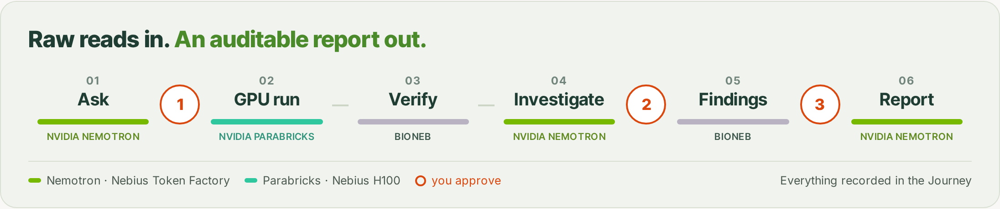
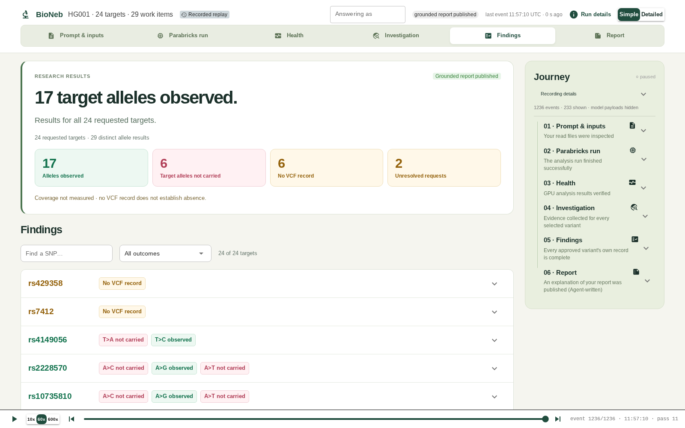
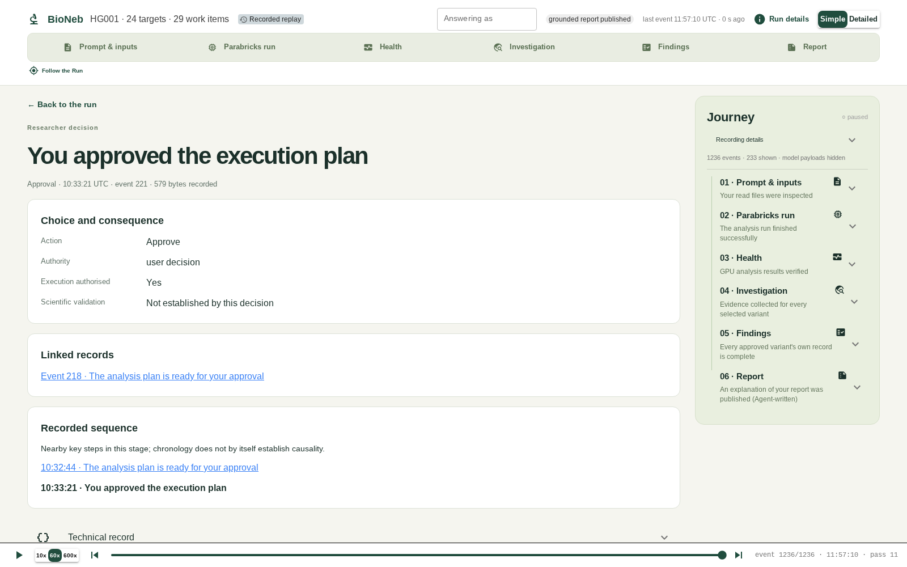

# Traceome

[](LICENSE)
[](https://www.python.org/)
[](https://build.nvidia.com/nvidia)
[](https://tokenfactory.nebius.com)
[](https://docs.nvidia.com/clara/parabricks/)
[](https://traceome.web.app)
[](https://traceome.web.app/demo.html)
[](https://youtu.be/FKvc8jEmv4k)

A genomics research Run you can watch, correct and fork. Raw FASTQ reads go in, and a report comes
out in which every statement points to its evidence. NVIDIA Nemotron agents on Nebius Token
Factory plan and investigate. NVIDIA Parabricks on a Nebius H100 calls the variants. A researcher
approves each consequential step, and every step is recorded in one append-only **Journey**.

> **Research use only.** Traceome is a research prototype, not a clinical or diagnostic tool.

Submission to the Nebius x NVIDIA Global AI Hackathon, track *Best Apps and Agents*.
Website: <https://traceome.web.app> · Demo: <https://traceome.web.app/demo.html> · Video: <https://youtu.be/FKvc8jEmv4k> · License: [MIT](LICENSE)



## What it does

A researcher asks a question, cites a paper or names the variants, and uploads the raw reads, for
example: *"Does HG001 carry these 24 rsIDs?"* Traceome then runs five stages:

1. **Plan (Nemotron).** A planning agent identifies the reference genome and prepares everything
   the alignment needs, as one exact proposal for NVIDIA Parabricks.
2. **Align and call (Parabricks).** Once the researcher approves that proposal, Parabricks runs as
   a Nebius Serverless AI job on an H100, aligning the reads and calling the variants. The output
   files are verified before anything builds on them.
3. **Investigate (Nemotron).** An agent looks up each variant with tools such as NCBI and EVA, and
   turns loose names into exact **Work items** for the researcher to approve.
4. **Findings (code + Nemotron).** Each Work item gets exactly one answer from the sample's own
   data: **observed**, **not carried**, **no VCF record** or **unresolved**. "No record" is never
   turned into "not carried". When the agent runs into a conflict, it brings it to the researcher,
   and only that item waits.
5. **Report (Nemotron).** Once the researcher approves the report basis, an agent writes the
   findings in plain words. It may cite only approved facts, and every citation opens that fact
   in the Journey.

Code checks every model output before it becomes a proposal, and nothing consequential runs
without an exact human approval.

## Quick start

You need Linux, Python 3.12, [uv](https://docs.astral.sh/uv/) and a
[Nebius Token Factory](https://tokenfactory.nebius.com) API key.

```bash
git clone https://github.com/stoleraviad/TraceOme.git && cd TraceOme
./scripts/setup-keys.sh                       # installs, then asks for your Token Factory key
./scripts/start-run.sh "Does this sample carry rs4149056 and rs429358?" \
    /path/to/R1.fastq.gz /path/to/R2.fastq.gz  # add --paper paper.pdf to cite a paper
```

Open **http://localhost:8770**. The researcher workspace shows the Run as it happens and asks
you each question and approval as a form. With the key alone, the agent plans the analysis, and
the Run then waits for the H100 setup in [Step 2](#step-2--nebius-execution). No key at all? Open
the [demo](https://traceome.web.app/demo.html).

## How a Run works


Every step appends typed facts to one **Journey**: model requests and replies, Tool calls,
source retrievals, approvals and content-addressed files. The report, the GUI, the command line
and the agents all read that same record.



*The Findings view of a recorded development Run on HG001. Every outcome opens to the VCF records
behind it.*

**The Journey** is the only durable record of a Run: append-only typed events plus write-once,
content-addressed artifacts under a run root outside the checkout. `observe`, `journey-feed` and
`run-artifacts` read it without contact and without changing a byte. Agents read it too, through a
`search_journey` Tool.

**Forking.** A finished Run can be forked from a chosen point. The child Run reuses the parent's
recorded evidence, leaves the parent byte-for-byte unchanged and asks for fresh approvals.



*Each approval is a recorded fact: what was approved, what it authorises and what it does not
establish.*

## NVIDIA Nemotron and Nebius

| Agent role | What it does | Default model |
| --- | --- | --- |
| `planning_agent` | Picks the reference genome and the Parabricks recipe | `nvidia/Nemotron-3.5-Super-VL` |
| `investigation_planner` | Resolves loose identifiers into exact Work items through NCBI and EVA Tools | same |
| `table_reader` | Reads the VCF window around each target | same |
| `report_explainer` | Writes the report's findings in plain words from the approved facts | same |
| `paper_reader` | Reads a cited paper for the variants it reports | same |

- **Nebius Token Factory** serves every model call through its OpenAI-compatible endpoint
  (`https://api.tokenfactory.us-north1.nebius.com/v1`). The same endpoint also served the
  Qwen3.5-397B comparison baseline, so changing models is a configuration change.
- **Nebius AI Cloud** runs one H100 job per Run: NVIDIA Parabricks `pbrun germline` 4.7.0, about
  9.5 minutes for HG001.
- **Nebius Object Storage** holds each Run's inputs and outputs in a fresh bucket.

## Setup

Requirements: Linux x86_64, Python 3.12 and [uv](https://docs.astral.sh/uv/). Each step below
adds one capability.

| Step | You get | You need |
| --- | --- | --- |
| 1 · Install and key | Agent planning: the request, the reference genome and the Parabricks recipe, every Journey view. The Run then stops at the Execution configuration Review | A Nebius Token Factory key |
| 2 · Nebius execution | The exact Parabricks proposal and its approval, the H100 job, Investigation, Finalization and the Grounded report | A Nebius AI Cloud project with H100 quota, a service account and the worker image |

No key at all? Open the demo replay above.

### Step 1 · Install and store your key

```bash
git clone https://github.com/stoleraviad/TraceOme.git && cd TraceOme
./scripts/setup-keys.sh          # runs uv sync, asks for the key, checks the setup offline
```

The key is written to `.bio-neb-local/model.env` (folder `0700`, file `0600`). Git ignores the
folder, and nothing else reads keys from the repository. Every command reads the key from its
environment, so pass the file with `--env-file`:

```bash
uv run --env-file .bio-neb-local/model.env python -m bio_neb.cli begin \
  --run-root $PWD/.bio-neb-local/live-runs/hg001-first \
  --prompt-file /abs/path/question.txt \
  --fastq read_1=/abs/path/R1.fastq.gz --fastq read_2=/abs/path/R2.fastq.gz \
  --interactive
```

Paths must be absolute. A run root goes under `.bio-neb-local/` or outside the checkout, and it
needs a fresh, unique name, because it also names the Run's storage bucket. FASTQ roles are
`read_1`/`read_2` (or `forward_read`/`reverse_read`). `begin` advances the Run until it needs a
human answer, then prints the question. Without step 2, the Run stops after planning, at the
Execution configuration Review.

```bash
uv run python -m bio_neb.cli observe --journey-file <run-root>/journey.jsonl [--rich]
uv run --env-file .bio-neb-local/model.env python -m bio_neb.cli answer \
  --journey-file <run-root>/journey.jsonl --request-event-id <id from observe> \
  --response-file answer.json                                        # records it and continues
uv run --env-file .bio-neb-local/model.env python -m bio_neb.cli resume --journey-file ...
uv run python -m bio_neb.cli journey-feed --journey-file ...           # plain-language feed
uv run --env-file .bio-neb-local/model.env python -m bio_neb.cli fork \
  --parent-journey-file ... --child-run-root $PWD/.bio-neb-local/live-runs/hg001-fork
```

### Follow a Run in the UI

`./scripts/start-run.sh` starts a Run and opens the researcher workspace on it (see
[Quick start](#quick-start)). It names the Run, writes your question to a file and calls
`gui/start_run.py`. To reopen a Run later, or replay a finished one, see [`gui/README.md`](gui/README.md).

### Step 2 · Nebius execution

The H100 step runs NVIDIA Parabricks in **your** Nebius project. The application's credentials
for storage are never stored locally: each job receives its storage secret from Nebius
MysteryBox.

1. **Nebius CLI 0.12.263.** The build pins this exact binary by size and sha256:
   ```bash
   curl -fsSL https://storage.eu-north1.nebius.cloud/cli/install.sh -o install-nebius.sh
   NEBIUS_CLI_VERSION=0.12.263 bash install-nebius.sh
   uv run python -m bio_neb.cli nebius-controller-preflight --nebius-executable ~/.nebius/bin/nebius \
     --run-root /tmp/traceome-preflight --receipt-file /tmp/traceome-preflight/receipt.json
   ```
2. **Service account and storage access**, in one project of region `eu-north1`. Create a
   service account inside the project, a group that contains it, an `editor` access permit for
   the group on the project, and one access key with MysteryBox delivery:
   ```bash
   nebius iam group create --name traceome --parent-id <tenant-id>
   nebius iam group-membership create --parent-id <group-id> --member-id <service-account-id>
   nebius iam access-permit create --parent-id <group-id> --resource-id <project-id> --role editor
   nebius iam v2 access-key create --name traceome --parent-id <project-id> \
     --account-service-account-id <service-account-id> --secret-delivery-mode mystery_box
   ```
   Keep the service account's authorized-key JSON at `~/.nebius/traceome-sa.json` (`chmod 600`),
   then make it a CLI profile:
   ```bash
   nebius profile create traceome-sa --service-account-file ~/.nebius/traceome-sa.json \
     --endpoint api.nebius.cloud:443 --parent-id <project-id>
   uv run python -m bio_neb.cli nebius-profiles --nebius-executable ~/.nebius/bin/nebius
   ```
3. **The worker image.** Build `containers/parabricks-worker/` and push it to your registry
   (`nebius registry create`). The build checks the worker module's sha256:
   ```bash
   WORKER_SHA256=$(sha256sum src/bio_neb/parabricks/reusable_object_storage_parabricks.py | cut -c1-64)
   docker buildx build --platform linux/amd64 --build-arg WORKER_SHA256=$WORKER_SHA256 \
     --file containers/parabricks-worker/Dockerfile \
     --tag cr.eu-north1.nebius.cloud/<registry-suffix>/traceome-parabricks-worker:<tag> --push .
   ```
4. **The account file**, `.bio-neb-local/parabricks-account.json`, binds the profile, the
   project, the subnet, the registry, the storage topology and the worker image. It names this
   clone's absolute path, so create it in the clone's final location.

> **Status.** Steps 1–3 work as written. In this release the worker image is pinned in
> `src/bio_neb/parabricks/execution_runtime.py`, and the account file is written by hand.
> A `setup-nebius` command that writes the file and accepts your own image is the next release.
> Until then, H100 Runs run on the maintainers' Nebius account; ask us for a live session.

## Tests

The offline suite needs no key and makes no contact. Run named modules, or every module:

```bash
uv run python -m unittest tests.test_cli tests.test_journey_path
ls tests/test_*.py | sed 's|/|.|; s|\.py$||' | xargs uv run python -m unittest
```

## Demo and evals

- **Demo replay** ([traceome.web.app/demo.html](https://traceome.web.app/demo.html)). The real Traceome GUI replaying the recorded Journey of a finished development
  Run on HG001, the public GIAB reference sample. Nothing in the replay starts Runs or spends money.
- **Evals** (`evals/`). Seven planning cases across pig, human (HG002, HG005), *C. elegans*,
  *B. subtilis*, rice and dog. `evals/core-files.yaml` lists each case's public inputs (NCBI
  references, ENA/SRA FASTQs) with their source URLs, md5 and sha256.

  ```bash
  uv run python -m evals.case compile --check     # cases and their compiled form agree
  uv run python -m evals.score --case s2-giab-hg002-clean-L2-snp3 \
      --journey-file <run>/journey.jsonl --output score.json
  ```

  `evals.prepare` builds a case's prompt, runtime and plan from the downloaded core files, and
  `evals.watch` stops a run at its request, source-read or stall limits. Results are judged by
  review of the recorded evidence; the scores assist that review.

## Data sources

| Source | Used for |
| --- | --- |
| [Genome in a Bottle](https://www.nist.gov/programs-projects/genome-bottle) HG001 reads | The development Runs on human data |
| NCBI: Datasets, E-utilities, genomes FTP, assembly reports, dbSNP RefSNP, Variation Services | Reference genomes, identifiers and variant records |
| [EVA](https://www.ebi.ac.uk/eva/) (European Variation Archive) | Variant records |
| ENA/SRA | Public FASTQ inputs of the eval cases (`evals/core-files.yaml`) |
| Europe PMC and PMC Open Access | Papers a researcher cites |
| Galaxy Project prebuilt reference indexes | Ready-made BWA indexes, fitted contig by contig |

Every lookup is recorded in the Journey as a contact, with what was asked and what came back.

## Hackathon submission

| Requirement | Where |
| --- | --- |
| NVIDIA open model through Nebius | Nemotron 3.5 Super VL on Nebius Token Factory for every agent role ([NVIDIA Nemotron and Nebius](#nvidia-nemotron-and-nebius)) |
| Other Nebius services | AI Cloud H100 jobs for Parabricks; Object Storage; MysteryBox for storage secrets |
| Demo video | <https://youtu.be/FKvc8jEmv4k> |
| Working demo | <https://traceome.web.app/demo.html>: the real GUI replaying a recorded Run; no account, key or install |
| Setup and run instructions | [Setup](#setup) |
| Open-source license | [MIT](LICENSE) |

## Results so far

All results come from **development Runs**, one Run each; formal evaluations are planned.

- One fresh Run went from raw FASTQ to a published, explained report with three human approvals:
  24 requested rsIDs became 29 Work items, giving 17 observed, 6 not carried and 6 with no VCF record.
- Two planted bad inputs (a nonexistent rsID and an incompatible one) were reported as unresolved,
  and no finding was invented for them.
- Swapping Qwen3.5-397B for Nemotron 3.5 Super VL changed no finding: 29/29 items were equal, and
  the VCF was identical record for record.
- The Nemotron Run made 145 requests, all HTTP 200. Its Journey recorded 1,834 facts and 337 files,
  all re-verified.

## What Traceome is not

- **Not a clinical tool.** It is research decision support. It makes no diagnosis and claims no
  function or causality, and "no record" never becomes "not carried".
- **Not autonomous, by design.** The agents investigate, but they can't settle every question
  alone. When evidence conflicts, it takes a knowledgeable researcher to drive the answer, so the
  researcher approves at the key points and nothing consequential runs without that approval.
- **Not a full analysis suite.** It is a prototype that answers one kind of question well: does
  this sample carry these variants? It was tested with one Parabricks workflow, a single paper at
  a time and one open-access literature source.
- **Not fully evaluated yet.** The results above come from development Runs. A formal evaluation,
  with repeated Runs and held-out cases, is planned.

## What's next

- More NVIDIA Parabricks workflows: RNA-seq, somatic calling, fusion detection, DeepVariant.
- From checking named variants to interpreting a sample: annotation, population frequency,
  structural variants.
- Several papers per question, and more literature sources.
- Comparing what several Runs found, across samples or questions, from their Journeys.
- Formal evaluations, scored by review of the recorded evidence.

## Repository map

| Path | What it is |
| --- | --- |
| `src/bio_neb/application/` | The Run coordinator, CLI commands and Journey readers |
| `src/bio_neb/agentic_journey/` | Shared Agent work: model turns, Tools, roles and their instructions |
| `src/bio_neb/parabricks/` | Planning, the Execution approval and the H100 execution |
| `src/bio_neb/investigation/` | Work items, VCF observation and literature sources |
| `src/bio_neb/reporting/` | Finalization, the Grounded report and its explanation |
| `src/bio_neb/providers/` | Adapters for NCBI, EVA, Galaxy and Nebius |
| `src/bio_neb/reference_discovery/`, `target_request/`, `paper_*`, `failure/` | Reference facts, target placement, paper intake and reading, failure handling |
| `gui/` | The researcher workspace (NiceGUI), which talks to Traceome only through its CLI |
| `src/bio_neb/devtools/` | Developer tooling: test runner and fixture exporters. The product never imports it |
| `scripts/` | `setup-keys.sh` (install and key) and `start-run.sh` (start a Run in the GUI) |
| `tests/` | Offline test suite (see [Tests](#tests)) |
| `evals/` | Planning eval cases, scorer and run watcher |
| `tools/` | Standalone developer tools (reference index, run health, variant sources, replay) |
| `containers/parabricks-worker/` | The H100 worker image |
| `docs/glossary.md` | Domain terms: Run, Journey, Review, Work item, Finalization basis |

## How it was built

Traceome was built in an agent-driven loop. AI coding agents implemented each ticket and AI
reviewers checked it. The owner made the decisions. Each slice was proven offline first, then in
a fresh live Run on the real model, H100 and storage.

## License

[MIT](LICENSE)
